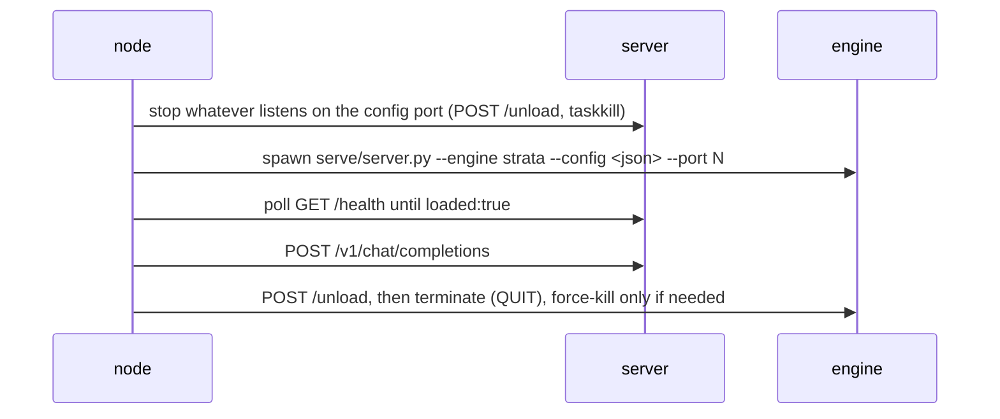

# comfyui-strata-nodes

Run [Strata](https://github.com/Niko1221/Strata) (Qwen3.8-Flash-Next, ggml) straight from
ComfyUI: the node **starts** the engine, **executes one prompt**, then **stops** it and
returns the text as a node output.

No server flags to learn and no second copy of the model - point the node at the folder
that already holds your configured Strata install (the one with `strata-<model>.json` in
it).

## Installation

Drop the pack into ComfyUI's `custom_nodes`, nothing else to install:

```text
ComfyUI/custom_nodes/
    comfyui-strata-nodes/
        __init__.py
        strata.py
```

Restart ComfyUI; the nodes appear as `Strata Run (start / prompt / stop)` and `Strata Config`.

- No `requirements.txt` and no pip step. Every import in `strata.py` is stdlib; the only
  non-stdlib names (`numpy`, `Pillow` behind the picture inputs, `psutil` for the
  process scan) already ship with ComfyUI, and each one is guarded or has a fallback.
- The nodes use ComfyUI's V3 node API (`comfy_api.latest`), so the host needs to be recent
  enough to have it - the same requirement as `LLMTextProcessorVL` in
  `ComfyUI-LLM-text-processor`.
- No download of weights or engines here - Strata owns that, see below.
- Windows in practice: the node reads `run-<model>.bat` and stops processes through
  `netstat -ano`, `tasklist` and `taskkill /T`. A `setup.sh` install has no `.bat` to read
  and no `taskkill`, so its start/stop cycle is not what this node was written for.

### Which Strata build this works with

The **Terminal / source install** of Strata, not the desktop app. The node drives it through
the files setup writes next to the model folder - `strata-<model>.json` (engine exe and args,
cwd, tokenizer, port, sampling, vision) plus `run-<model>.bat` (the exact start command) - and
spawns `serve/server.py` itself. The app keeps its run settings in its own state under
`%LOCALAPPDATA%\Strata\` (components and install folders) rather than next to the weights, so
pointing `folder` at a models library the app filled in finds no config - `_load_config` raises
before anything touches the GPU.

Prepare a folder once with setup, non-interactively, then point `folder` at it:

```bat
cd /d D:\AI\models\Strata
START-HERE.bat --family qwen --model Q2_0 --yes
```

That leaves `strata-Q2_0.json` and `run-Q2_0.bat` in the same folder, which is exactly what the
node needs. Pick a pack that fits your machine - `Q2_0` is an example size, not a minimum.

What Strata itself requires (Python deps, `.venv`, engine package for your card, GPU and driver
rules, model sizes) belongs to upstream, not to this pack: see the [Niko1221/Strata](https://github.com/Niko1221/Strata)
repo - `docs/INSTALL.md` (Terminal vs app), `docs/TERMINAL_LAUNCH.md` (`strata launch`, flags,
presets) and `docs/SOURCE_INSTALL.md` (the checkout route that writes the `.json` / `.bat` files).
Strata's own `requirements.txt` lives there; this pack adds nothing to it.

## Nodes

| Node | Purpose |
| --- | --- |
| `Strata Run (start / prompt / stop)` | prompt in, text out |
| `Strata Config` | folder path in, parsed config + exact start command out (no GPU work) |

### StrataRun inputs

| Input | Default | Notes |
| --- | --- | --- |
| `folder` | - | the configured Strata folder, e.g. `d:\AI\models\Strata` |
| `port` | 8080 | the port to own (1..65535). Whatever Strata server already listens there gets stopped first, then the node starts its own on that same port. Leave it at 8080 and the port from `strata-<model>.json` is used instead - any other number overrides the config |
| `prompt` | - | the request |
| `system` | `""` | optional system message |
| `ref_images` | off | a growing group of picture sockets, `ref_image_0..ref_image_8`, same names and order as `LLMTextProcessorVL`; each socket may itself be a batch (B,H,W,C) - every frame becomes its own Picture |
| `first_frame` | off | an IMAGE that is sent only when `also_ref_first_frame` is on, appended after the refs so it takes the next Picture ordinal |
| `last_frame` | off | keyframe pin; accepted for layout parity and never sent to Strata |
| `also_ref_first_frame` | `false` | expose `first_frame` as the next Picture reference |
| `max_tokens` | 4096 | 1..131072 |
| `thinking` | `config` | `config` keeps the value from `strata-<model>.json`, or force `none/low/medium/high` |
| `startup_timeout` | 900 | seconds to wait for the model to load (first load is slowest) |
| `prompt_timeout` | 1800 | seconds for the completion request |
| `temperature` | 1.0 | sampling temperature (0..2); default mirrors the current config, `-1` keeps whatever `strata-<model>.json` says |
| `top_p` | 0.95 | nucleus sampling (0..1); default mirrors the config, `-1` keeps it |
| `top_k` | 20 | top-k candidates (the engine caps this at 64); default mirrors the config, `-1` keeps it |
| `min_p` | 0.0 | min-p sampling (0..1); default mirrors the config, `-1` keeps it |
| `presence_penalty` | 0.0 | penalise tokens already present, curbs loops and repeated refusals; default mirrors the config (`-1` keeps it) |
| `frequency_penalty` | 0.0 | penalise tokens by how often they appear; default mirrors the config (`-1` keeps it) |
| `repetition_penalty` | 1.05 | penalise any token seen in the last window; default mirrors the config (`-1` keeps it) |
| `penalty_last_n` | 512 | how many past tokens the penalties look at; default widened to 512 (the config uses 64), `-1` keeps the config value |
| `unload_after` | `true` | stop the server and free VRAM/RAM when the prompt finishes |
| `seed` | 0 | non-zero reuses the cached result instead of loading the model again |
| `bypass` | `false` | when `true` the node does nothing with Strata at all: it never reads the folder, never touches the port or the GPU, and simply returns the prompt as `result` (empty `reasoning`, `run info` = `{"bypass": true}`) |

All picture sockets are optional and may stay disconnected - with none connected the node sends
a plain text message, exactly as before. With pictures connected, they go out as ordered
`image_url` parts ahead of the prompt text, one part per picture, in socket order; Strata reads
image parts only (it has no audio or video part type), so `ref_videos` / `ref_audios` sockets from
the VL node have no counterpart here. The vision guard still applies: connecting any picture to a
Strata install without `vision` in its config raises before anything is started.

### StrataRun outputs

1. `result` - the assistant text
2. `reasoning` - `reasoning_content` when the model emits it, otherwise empty
3. `run info` - JSON: model, port, seconds, unload state, token usage
  plus `stopped_existing_server` (`true` when a server you were running outside ComfyUI had to be shut down first)
  and `pictures` (how many image parts went out)

## Lifecycle

Strata pins tens of GB of VRAM and RAM, so only one instance can be resident at a time.
Every `StrataRun` execution therefore does the whole cycle:



The start command is taken from `run-<model>.bat` verbatim (only `--open` is dropped), so
whatever setup wrote - pack paths, expert profile, control vectors, sampling block - stays
in effect. The node never uses `--lazy`: it waits for `loaded:true` before prompting.

Stopping is process-list driven, not socket driven. Killing only the process that owns the
listening socket leaves the launcher chain behind (`cmd.exe /c START-HERE.bat` -> `setup.py`
-> `server.py`), which simply starts a fresh server on the same port again - and then every
`/health` answer comes from that other server while the node waits for its own copy. So the
node scans the process list for everything whose command line or working folder belongs to
the Strata folder (server, `engine\strata.exe` child, vision helper, launcher) and
terminates each with `taskkill /T`, then `/F /T`, then `/F`.

If cleanup cannot free the port, the node **refuses to load a second model**: it raises
before spawning, so no two copies ever fight over the same GPU. Same guard while loading -
if some other process takes the port back, the run fails instead of prompting the wrong
server.

Stderr of the spawned server goes to `_comfynode-<port>.log` inside the Strata folder.

## Notes

- Requires the ComfyUI process and Strata to share one machine; the node talks only to
  `127.0.0.1:<port>` - the `port` input, or the port from the config when you leave it alone.
- The pack registers through `comfy_entrypoint`, so both nodes appear once ComfyUI restarts;
  nothing is started at import time - a Strata instance you are already running elsewhere stays
  untouched until a `StrataRun` actually executes.
- If a ComfyUI workflow runs several times, each run reloads the model (tens of seconds to
  minutes). Use `seed` non-zero to keep the first result and skip the reload.
- Set `unload_after` to `false` only when nothing else needs the GPU afterwards; the node
  still ends the process at graph completion unless you do that yourself.

## License

This pack (the two node files and its docs) is MIT licensed - see `LICENSE`. It covers this repo
only: Strata itself, its engine packages and the model weights all belong to upstream and keep
their own terms, so re-check those before redistributing a bundle that includes them.
