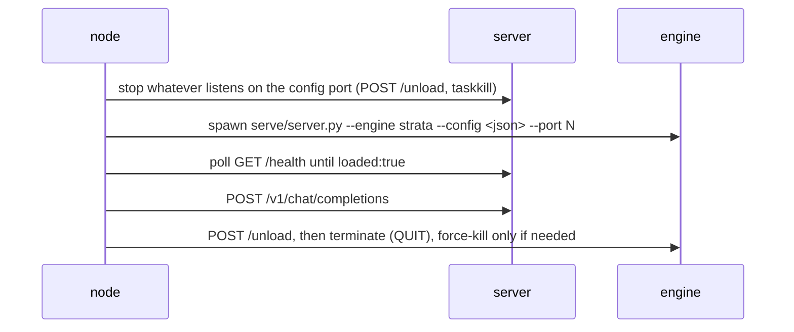

# comfyui-strata-nodes

Run [Strata](https://github.com/Niko1221/Strata) (Qwen3.8-Flash-Next, ggml) straight from
ComfyUI: the node **starts** the engine, **executes one prompt**, then **stops** it and
returns the text as a node output.

No server flags to learn and no second copy of the model - point the node at the folder
that already holds your configured Strata install (the one with `strata-<model>.json` in
it).

## Nodes

| Node | Purpose |
| --- | --- |
| `Strata Run (start / prompt / stop)` | prompt in, text out |
| `Strata Config` | folder path in, parsed config + exact start command out (no GPU work) |

### StrataRun inputs

| Input | Default | Notes |
| --- | --- | --- |
| `folder` | - | the configured Strata folder, e.g. `d:\AI\models\Strata` |
| `port` | 8080 | the port to own (1..65535). Whatever Strata server already listens there gets stopped first, then the node starts its own on that same port. Leave it at 8080 and the port from `strata-<model>.json` is used instead - any other number overrides the config |
| `prompt` | - | the request |
| `system` | `""` | optional system message |
| `image` | off | optional IMAGE; needs `vision` in the Strata config |
| `max_tokens` | 4096 | 1..131072 |
| `thinking` | `config` | `config` keeps the value from `strata-<model>.json`, or force `none/low/medium/high` |
| `startup_timeout` | 900 | seconds to wait for the model to load (first load is slowest) |
| `prompt_timeout` | 1800 | seconds for the completion request |
| `unload_after` | `true` | stop the server and free VRAM/RAM when the prompt finishes |
| `seed` | 0 | non-zero reuses the cached result instead of loading the model again |

### StrataRun outputs

1. `result` - the assistant text
2. `reasoning` - `reasoning_content` when the model emits it, otherwise empty
3. `run info` - JSON: model, port, seconds, unload state, token usage
  plus `stopped_existing_server` (`true` when a server you were running outside ComfyUI had to be shut down first)

## Lifecycle

Strata pins tens of GB of VRAM and RAM, so only one instance can be resident at a time.
Every `StrataRun` execution therefore does the whole cycle:

The start command is taken from `run-<model>.bat` verbatim (only `--open` is dropped), so
whatever setup wrote - pack paths, expert profile, control vectors, sampling block - stays
in effect. The node never uses `--lazy`: it waits for `loaded:true` before prompting.

Stopping is process-list driven, not socket driven. Killing only the process that owns the
listening socket leaves the launcher chain behind (`cmd.exe /c START-HERE.bat` -> `setup.py`
-> `server.py`), which simply starts a fresh server on the same port again - and then every
`/health` answer comes from that other server while the node waits for its own copy. So the
node scans the process list for everything whose command line or working folder belongs to
the Strata folder (server, `engine\strata.exe` child, vision helper, launcher) and
terminates each with `taskkill /T`, then `/F /T`, then `/F`.

If cleanup cannot free the port, the node **refuses to load a second model**: it raises
before spawning, so no two copies ever fight over the same GPU. Same guard while loading -
if some other process takes the port back, the run fails instead of prompting the wrong
server.

Stderr of the spawned server goes to `_comfynode-<port>.log` inside the Strata folder.

## Notes

- Requires the ComfyUI process and Strata to share one machine; the node talks only to
  `127.0.0.1:<port>` - the `port` input, or the port from the config when you leave it alone.
- If a ComfyUI workflow runs several times, each run reloads the model (tens of seconds to
  minutes). Use `seed` non-zero to keep the first result and skip the reload.
- Set `unload_after` to `false` only when nothing else needs the GPU afterwards; the node
  still ends the process at graph completion unless you do that yourself.
